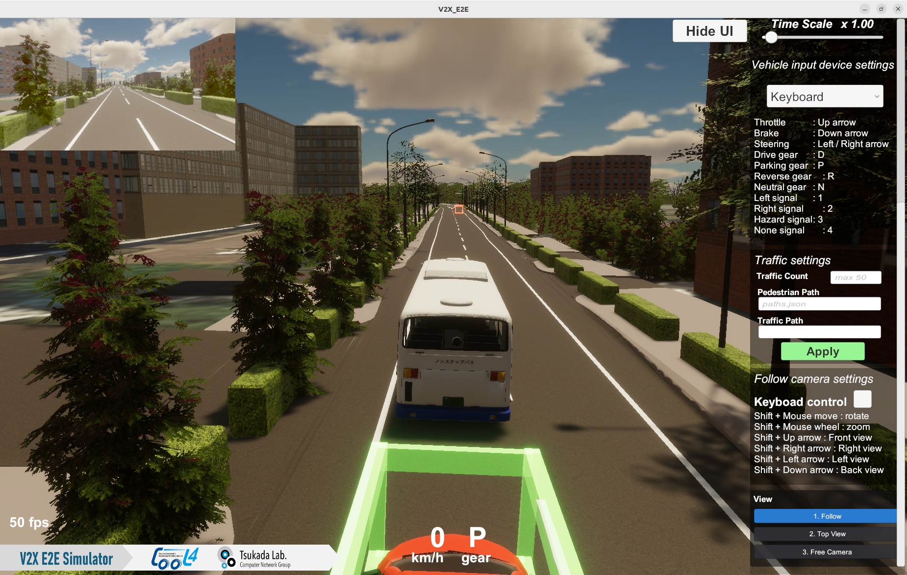
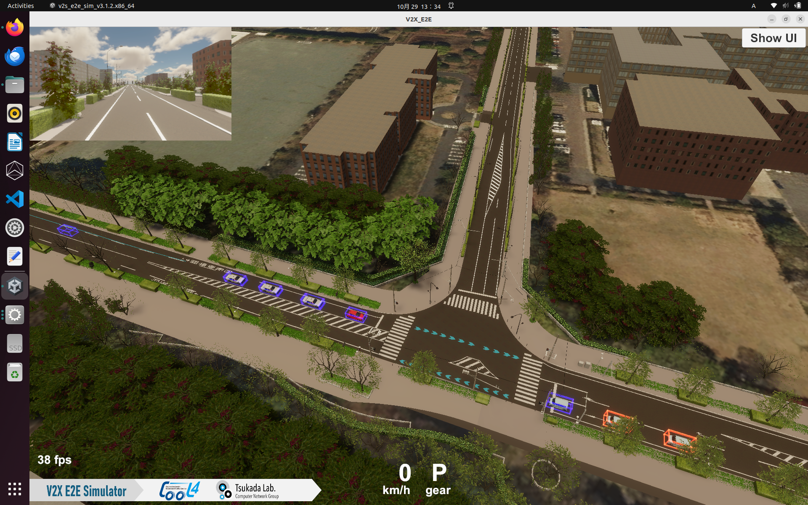
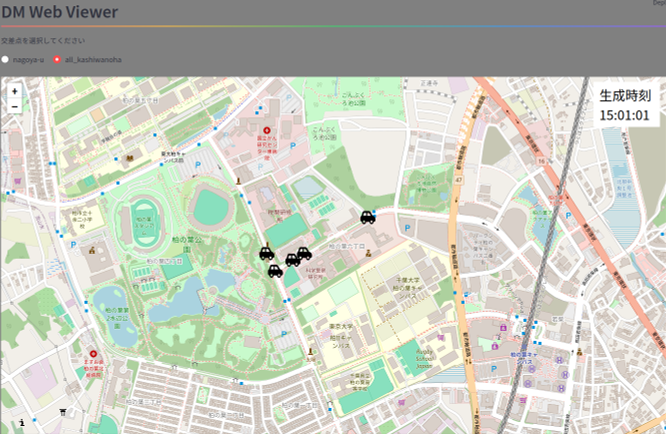

# V2X E2E Simulatorとの連携
## 1. 概要
---

DM2.0は、[V2X E2E Simulator](https://tlab-wide.github.io/V2X_E2E_Simulator/latest/)との連携に対応しています。

V2X E2E Simulatorは、AWSIMをベースとしたV2Xシミュレーション環境です。DM2.0では、シミュレータが生成する物標情報や信号情報を取り込むことができます。

これにより、実際の路側センサーを用意することなく、仮想環境で生成されたデータを利用して、DM2.0やV2Xアプリケーションの開発・検証を行うことができます。

---

## 2 動作確認環境

- Ubuntu 22.04
- ROS2 Humble
- GPU RTX2080Ti以上

## 3 導入手順

### 3.1 V2X E2E Simulatorの起動

- [V2X E2E Simulator 公式ドキュメント](https://tlab-wide.github.io/V2X_E2E_Simulator/latest/)のQuick Start Demoを参照し、デモが実行できる状態にして下さい。

- 実行ファイルに実行権限を付与し、起動します。2026年10月の最新版`Version3.1.2`を例にすると、下記のコマンドになります。

```bash
chmod +x v2s_e2e_sim_v3.1.2.x86_64
./v2s_e2e_sim_v3.1.2.x86_64
```

- 起動すると、車両視点の画面が表示されます。



- 右のUIから`Top View`を選択することで、俯瞰視点に切り替える事が可能です。



### 3.2 DM2.0のDBシステムの起動

DM2.0のインストール方法について、ここではGitHub Container Registry (GHCR)を利用した手順を紹介します。

Dockerがインストールされている環境にて、下記コマンドでDockerイメージを取得します。

```bash
docker pull ghcr.io/dm20-consortium/dm2-is:latest-ubuntu22.04
docker pull ghcr.io/dm20-consortium/dm2-rdb:latest
docker pull ghcr.io/dm20-consortium/dm2-mes:latest-ubuntu22.04
```

RDB (PostgreSQL) コンテナを起動させます。

```bash
docker run --init --rm --net host --name rdb -e POSTGRES_PASSWORD=postgres \
    ghcr.io/dm20-consortium/dm2-rdb:latest
```

- [リポジトリのルートディレクトリ/dm2/conf/dmiConf.yml](../../dm2/conf/dmiConf.yml)をV2X E2E Simulator用に書き換えます。

```bash
cd ~/dm20/dm2/conf
cp for_V2X_E2E_Sim/dmiConf.yml .
```

上記で書き換えた内容は以下の通りです。物標情報と信号情報の`topicName`をV2X E2E Simulatorがパブリッシュするトピック名に合わせています。

```text
  ros2:
    subscriber:
      object_info:
        targetTable: object_info_0_8_1
        topicName: /v2x/object_info
        topicType: ObjectInfoArray
        logIntervalMilliSecond: 300000
      signal_info:
        targetTable: signal_info
        topicName: /signal_info
        topicType: SignalInfoArray
        logIntervalMilliSecond: 300000
```

DBシステムを起動します。`PROJECT_DIR`は、適宜、書き換えて下さい。

```bash
PROJECT_DIR=~/dm20
docker run -it --init --rm --net host --name is \
    -e ROS_DOMAIN_ID=0 \
    -e RMW_IMPLEMENTATION=rmw_cyclonedds_cpp \
    -e ROS_LOCALHOST_ONLY=1 \
    -v ${PROJECT_DIR}/dm2/conf:/tmp/conf \
    ghcr.io/dm20-consortium/dm2-is:latest-ubuntu22.04 \
    dm2is -d /tmp/conf
```

### 3.3 シミュレータが生成する物標情報・信号情報の受信確認

DMメッセンジャーを使って、物標情報が受信できているか確認できます。

```bash
docker run -it --rm --net host \
    ghcr.io/dm20-consortium/dm2-mes:latest \
    stdbuf -oL dm2mes -r -S object_info_0_8_1 -w 50
```

同様に、信号情報が受信できているか確認できます。

```bash
docker run -it --rm --net host \
    ghcr.io/dm20-consortium/dm2-mes:latest \
    stdbuf -oL dm2mes -r -S signal_info -w 50
```

### 3.4 DM Web Viewerによる表示

DM Web Viewerを使って、Webブラウザ上で表示する事が可能です。

[DM Web Viewerのクイックスタート](../../viewer/web-viewer/README.md#クイックスタート)の手順1～3を実施します。

DMメッセンジャーの出力先を、DM Web Viewerのクイックスタート手順2で指定したパスに設定します。

```bash
docker run -it --rm --net host \
    ghcr.io/dm20-consortium/dm2-mes:latest \
    stdbuf -oL dm2mes -r -S object_info_0_8_1 -w 50 > /tmp/dm2-web-viewer/csv/object_info_0_8_1_`date +"%Y%m%d"`.csv 
```

下記のように、Webブラウザ上でV2X E2E Simulatorの物標情報が表示されます。




### 4 複数端末を使った構成

- 端末を2台以上用意することで、V2X E2E Simulatorが生成した物標情報や信号情報を別の端末に送信する事が可能です。
- 2台のDM端末間の通信動作例については、[こちら](../../example/README.md)

